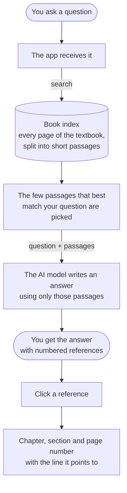

<div align="center">

# TEM-AI

### A study companion for transmission electron microscopy

Ask a question. Get a clear answer.<br/>
See exactly where in the textbook it comes from.

[**Open the live site →**](https://tem-ai-assistant.vercel.app)

</div>

<br/>

## What it is

TEM-AI is a question-and-answer assistant for students and researchers working with transmission electron microscopes. It answers from the standard textbook, *Transmission Electron Microscopy: A Textbook for Materials Science* by Williams and Carter, and every statement in an answer carries a small numbered reference so you can check it yourself.

It is built for quick questions in the middle of study or lab work: what a term means, why an image looks the way it does, how to index a pattern, what to try when the alignment is off.

<br/>

## How it works



In plain words: your question is never answered from memory alone. The app first looks the topic up in the book, hands the relevant passages to the AI model, and asks it to answer from those. That is why each answer can point back to a page.

<br/>

## What you can do with it

| | |
|---|---|
| **Ask** | A direct answer with references, for quick questions. |
| **Tutor** | The idea built up in a few steps, ending with a question to check your understanding. |
| **Exam** | A model answer in the format you choose: 2, 5 or 10 marks, viva, or multiple choice. |
| **Laboratory** | Practical help at the microscope: what to check, likely causes, and what to do. |

Alongside the assistant there is a small set of study tools:

- **Column anatomy** — the microscope column, taken apart stage by stage
- **Diffraction simulator** — spot and ring patterns, and the electron wavelength at any voltage
- **Micrograph analysis** — particle sizes from an image
- **Exam practice** — questions with marking rubrics
- **Concept map** — how the topics connect
- **Technique guide** and **Troubleshooter** — choosing a technique, and fixing common imaging faults

The site works on a phone, and has a light and a dark theme.

<br/>

## About the references

A reference tells you where to look, in as much detail as the site is allowed to show.

- **On the public site** you see the chapter, the section, the printed page number, where on the page the passage sits, and a short quotation. Open your own copy of the book to read it in full. The book's pages are not shown or stored on the public site.
- **On your own computer**, with your own copy of the PDF, a reference opens the actual page with the cited lines highlighted.

Answers are written by an AI model and can be wrong. The references are there so you can check.

<br/>

## Run it on your own computer

You need [Node.js](https://nodejs.org) and a free Google Gemini API key.

```bash
npm install
```

Create a file named `.env.local` containing your key:

```
GEMINI_API_KEY=your-key-here
```

Then start it and open http://localhost:3000

```bash
npm run dev
```

**To use your own copy of the textbook**, put the PDF in a folder named `book` and run:

```bash
npm run index-book
```

The PDF stays on your computer. The `book` folder is never uploaded to GitHub.

<details>
<summary>Putting the book index behind a deployed site</summary>

<br/>

The deployed site can search the book without ever showing its pages. The index is kept in private storage that only the server can read.

1. Create a Supabase project and add `SUPABASE_URL` and `SUPABASE_SERVICE_ROLE_KEY` to `.env.local`.
2. Run `npm run upload-book-index`. It uploads the index to a private bucket and checks that it cannot be read without the key.
3. Add the same two variables to your hosting provider's environment settings and redeploy.

</details>

<br/>

## Good to know

TEM-AI is a study and reference aid. It does not replace your instrument's manual, your facility's training, or laboratory safety procedures.

The textbook belongs to its authors and publisher. This project does not include it; you need your own copy.
